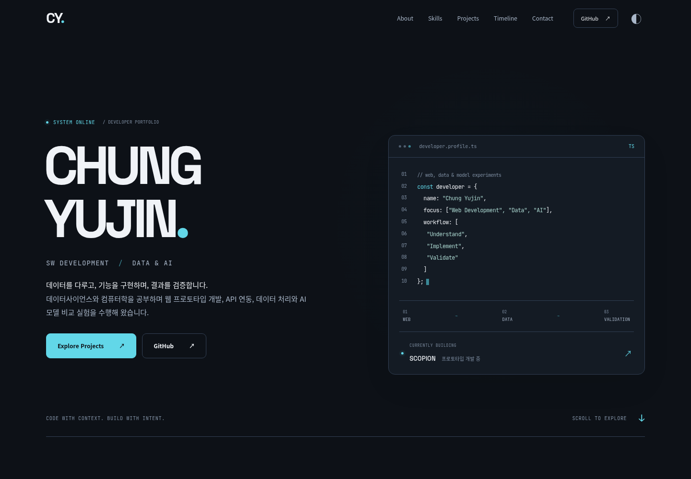

# Chung Yujin · 인터랙티브 개발자 포트폴리오

[사이트 보기](https://ipp-portfolio-hazel.vercel.app/) · [실사이트 테스트](https://github.com/solw29/ipp-portfolio/actions/workflows/live-browser-test.yml) · [소스 코드](https://github.com/solw29/ipp-portfolio)

개발 경험과 프로젝트의 담당 역할·구현 과정·검증 결과를 전달하기 위해 만든 **반응형 정적 프론트엔드 프로젝트**입니다. 단순한 이력서 나열 대신, 데이터 기반 콘텐츠 관리와 Canvas 인터랙션, 접근성을 함께 구현했습니다.

Graphite Cyan 디자인을 바탕으로 TypeScript와 Vite를 사용합니다. 홈과 네 개의 상세 페이지를 빌드 시 HTML로 생성하고 Vercel에 배포하는 구조입니다.



## 프로젝트에서 구현한 것

| 영역 | 구현 내용 |
|---|---|
| 페이지 구성 | Hero, 소개, 기술 스택, 프로젝트 갤러리, 타임라인, 연락처와 상세 페이지 4개 |
| 콘텐츠 구조 | 프로필·프로젝트·기술 목록을 데이터 파일로 분리하고 공통 렌더링 함수로 정적 페이지 생성 |
| 커스텀 커서 | SVG 화살표, Catmull–Rom 경로를 따른 다층 꽃잎 트레일, 클릭 점에서 확장되는 리플 |
| 카드 인터랙션 | 포인터 위치에 집중되는 Cyan 테두리와 외부 Glow, 크기 변화 없는 Hover와 아이콘 확대 |
| 프로젝트 탐색 | 비대칭 Bento Grid, 분야별 필터, FLIP 재배치, 이전/다음 상세 페이지 이동 |
| 스크롤·이동 | 한 번만 실행되는 순차 등장, 현재 섹션 표시, 지원 브라우저의 View Transitions |
| 자료 표현 | 실제 시연 영상·발표 포스터·CSV 기반 차트·다운로드 링크, 대체 이미지 없이 자료가 있을 때만 표시 |
| 반응형·접근성 | 모바일 메뉴, 키보드 포커스 이동, 본문 바로가기, 텍스트 대체 설명, Reduced Motion, 터치 환경 기본 커서 |
| 검증 자동화 | Vercel 실주소에 접속하는 Chromium 테스트와 영상·화면·JSON 결과를 GitHub Actions에 보관 |

사이트에서 소개하는 연구 프로젝트의 PyTorch·TensorFlow·RAG 실험과 **이 웹사이트를 구현한 기술은 구분**합니다. 웹사이트 자체에는 React, 서버 API, 데이터베이스, 로그인이나 CMS를 사용하지 않았습니다.

## 사용 기술

- **TypeScript**: 콘텐츠 타입, UI 이벤트와 커서 상태 관리
- **Vite**: 개발 서버, SSR 모듈 로딩을 이용한 정적 HTML 생성 준비, 프로덕션 번들링
- **HTML / CSS**: Grid·Flex 레이아웃, 반응형 화면, CSS 마스크를 이용한 테두리 강조, 테마와 전환 효과
- **Canvas 2D / SVG**: 커서·그라데이션 트레일·클릭 리플·로컬 기술 아이콘
- **Playwright / Chromium**: 실제 마우스·키보드·터치 입력과 페이지 이동 검증, 영상 기록
- **Vercel / GitHub Actions**: 정적 사이트 배포 설정 및 실사이트 회귀 검사

폰트는 Fontsource 패키지에서 번들링합니다. 기술 아이콘은 로컬 Simple Icons 패키지와 Devicon SVG를 사용합니다. 원본 Notion의 기술 목록은 5개 카테고리·15개 카드이며, 이는 프로젝트·학습 경험 목록입니다. JSP는 검증된 독립 로고를 확보하지 못해 별 아이콘으로 표시합니다.

## 설계와 문제 해결

### 정적 생성과 직접 접근 가능한 상세 주소

`scripts/generate.mjs`가 TypeScript 렌더링 함수를 로드해 홈과 각 프로젝트의 `index.html`을 작성하고, Vite가 이를 여러 진입점으로 빌드합니다. 본문과 페이지별 메타데이터가 초기 HTML에 포함됩니다. 상세 주소로 직접 들어가거나 새로고침해도 SPA 재작성 없이 해당 페이지를 제공합니다.

### 커서 상태를 콘텐츠와 분리

일반 제목·본문 위로 이동하거나 스크롤할 때 커서를 전체 초기화하던 문제를 수정했습니다. 현재는 화살표 표시 상태와 Canvas 잔상 정리를 분리합니다. 실제 마우스 사용과 복합 입력 장치를 고려하며, 입력·편집·텍스트 선택·터치·Reduced Motion에서는 기본 커서를 유지합니다.

### 트레일 성능 최적화

최근 좌표는 최대 48개만 보관하고 Canvas DPR은 1.5로 제한합니다. 여러 겹의 꽃잎과 blur·그라데이션을 오프스크린 Canvas에 한 번 계산한 뒤 재사용합니다. 프레임마다 DOM이나 그라데이션을 새로 만들지 않으며, 잔상과 리플이 사라지면 애니메이션 루프도 중단합니다.

### 콘텐츠 정확성과 유지보수

개인 실험과 팀 구현, 완료한 결과와 진행 중인 작업을 구분합니다. 실제 실험 값은 데이터 파일과 원본 CSV를 근거로 표시하며, 제공되지 않은 화면·실적·이미지는 만들지 않습니다. 기업 지원 문구와 전화번호 공개는 콘텐츠 설정으로 제어합니다.

## 실행

Node.js 22.12 이상 또는 24 LTS를 사용합니다.

```sh
npm ci
npm run dev
```

프로덕션 빌드와 로컬 확인:

```sh
npm run check
npm run build
npm run preview
```

`dist/`가 배포 결과물입니다. `vercel.json`에 Vite 빌드, 출력 폴더와 상세 페이지 URL 설정이 있습니다. 데이터·렌더링 함수 수정 후에는 개발 서버를 재시작하거나 다시 빌드해 정적 HTML을 갱신합니다.

## 실사이트 테스트와 영상 확인

**GitHub → Actions → “Vercel 실사이트 브라우저 검증”**에서 실행을 선택합니다. 완료된 실행의 **Artifacts → `vercel-chromium-커밋SHA`**에서 다음 자료를 받습니다.

- `report.json`: 실제 테스트 URL, 기대/실제 배포 커밋, 검사 결과와 오류
- `videos/*.webm`: Chromium의 실제 동작 영상
- `desktop.png`, `mobile.png`: 테스트 화면

테스트는 성공 여부와 관계없이 가능한 결과를 업로드합니다. 설치나 네트워크 단계에서 실패하면 영상이 없을 수 있으며, 이 경우 작업 로그와 JSON에 기록된 오류를 확인합니다. 산출물은 14일 보관됩니다.

자동 실행은 관련 소스가 `main`에 푸시될 때 시작합니다. Actions에서 **Run workflow**로 수동 실행할 수도 있습니다. 테스트는 Vercel의 `build-revision`이 해당 GitHub 커밋과 일치할 때까지 최대 약 6분 기다립니다. 이전 배포를 최신 코드의 테스트로 보고하지 않으며, 배포 불일치는 실패로 표시합니다.

검사 범위:

- 홈의 프로젝트·기술 카드 수, 프로젝트 번호와 대표 실험 수치
- 제목·본문·내비게이션·카드·상세 페이지에서 커서 표시
- 빠른/느린 트레일, 정지 후 소멸, 클릭 리플, 스크롤 후 표시 유지
- Hover 크기 유지와 Cyan 강조, 프로젝트 필터·현재 섹션 내비게이션
- 상세 페이지 4개 직접 접근, 실제 시연 영상과 포스터 응답
- 반응형 가로 넘침, 모바일 메뉴의 키보드 동작, 터치·Reduced Motion
- 브라우저 예외, 콘솔 오류와 사이트 자원의 HTTP 오류

같은 테스트를 로컬 프로덕션 빌드에 실행하려면 `npm run preview`를 켠 상태에서:

```sh
npx playwright install chromium
TEST_BASE_URL=http://localhost:4173 npm run test:live
```

다른 Chromium 실행 파일을 사용할 경우 `CHROMIUM_PATH`를 설정할 수 있습니다. 결과는 기본 `test-results/live/`에 저장되며 Git에는 포함하지 않습니다.

> 로컬 빌드 검증과 Vercel 실사이트 검증은 별개입니다. 이 개발 클라우드에서는 Vercel 주소가 네트워크 정책으로 차단되므로 직접 실사이트 성공을 단정하지 않습니다. 실제 배포 결과는 위 Actions 실행의 상태·배포 SHA·영상을 기준으로 확인합니다.

## 폴더 구조

```text
src/
  data.ts                 프로필·프로젝트·기술 목록 및 공개 설정
  home.ts                 홈 섹션과 프로젝트 카드
  ui.ts                   공통 UI·연락처·커서 마크업
  project-page.ts         프로젝트 상세와 이전/다음 탐색
  evidence.ts             실제 영상·포스터·차트·자료 갤러리
  render.ts               문서·메타데이터·페이지 조합
  main.ts                 메뉴·필터·스크롤·테마 인터랙션
  cursor.ts               마우스 상태·트레일·리플
  skill-icons.ts, icons/  로컬 기술 아이콘과 출처 라이선스
  style.css               Graphite Cyan 스타일과 반응형 화면
scripts/
  generate.mjs            빌드용 정적 HTML 생성
  test-live.mjs           실사이트 Chromium 검증 및 기록
  verify-results.py       제공된 CSV 요약 검증
  prepare-results.py      실험 결과 JSON 갱신
  plot-results.py         CSV 기반 그래프 생성
public/                   실제 시연 영상·포스터·실험 자료
.github/workflows/        실사이트 테스트 자동화
```

## 콘텐츠 수정

`src/data.ts`에서 프로필·프로젝트·기술 목록을 수정합니다.

- `contentSettings.application.enabled`: 기업 지원 문구 표시. 기본은 공개용 비표시입니다.
- `application.company / role / program`: 실제 공식 명칭 확인 후 입력합니다. 미확인 프로그램명은 null로 둡니다.
- `contentSettings.showPhone`: 전화번호 공개 여부.
- 프로젝트의 `visuals`: 실제 차트·다이어그램·스크린샷 경로, alt, 설명과 크기를 추가합니다. 자료가 없으면 빈 UI를 만들지 않습니다.

실험 CSV를 갱신해야 할 경우 `verify-results.py` → `prepare-results.py` → `plot-results.py` 순으로 실행한 후 다시 빌드합니다. 일반 웹 빌드는 Python 없이 실행되며, 그래프 재생성에만 Matplotlib이 필요합니다.

## 검증 기록

다음 기록은 해당 시점의 **로컬 프로덕션 빌드**를 검증한 자료입니다. 최신 실사이트 검증 여부는 Actions에서 확인합니다.

- [커서 표시 문제 재현과 수정](docs/cursor-fix/README.md)
- [카드 Glow·꽃잎 트레일 최적화와 동작 영상](docs/design-refinement/README.md)
- [콘텐츠 및 Skills 근거 정리](docs/content-refinement/README.md)
- [원본 Notion 기준 15개 기술·반응형 화면과 영상](docs/notion-tech-stack/README.md)

현재 웹사이트를 하나의 프론트엔드 구현 사례로 소개하기 위한 README이며, 사이트에 소개된 팀 프로젝트의 성과를 이 웹사이트 자체의 성과로 합산하지 않습니다.
